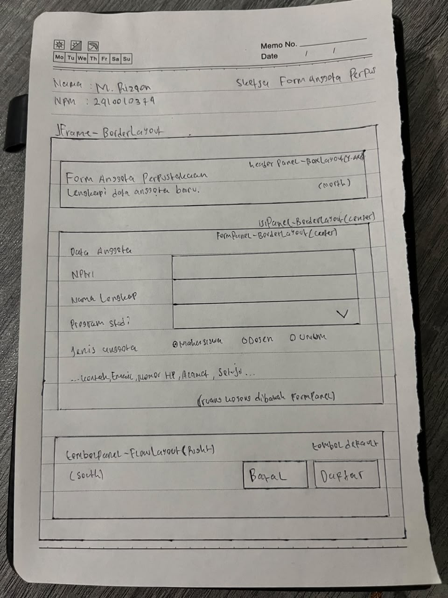
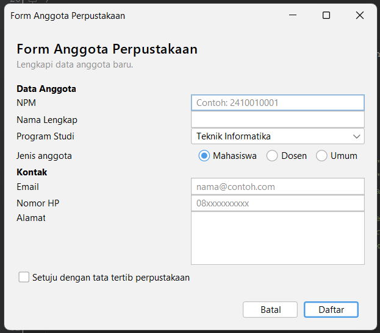
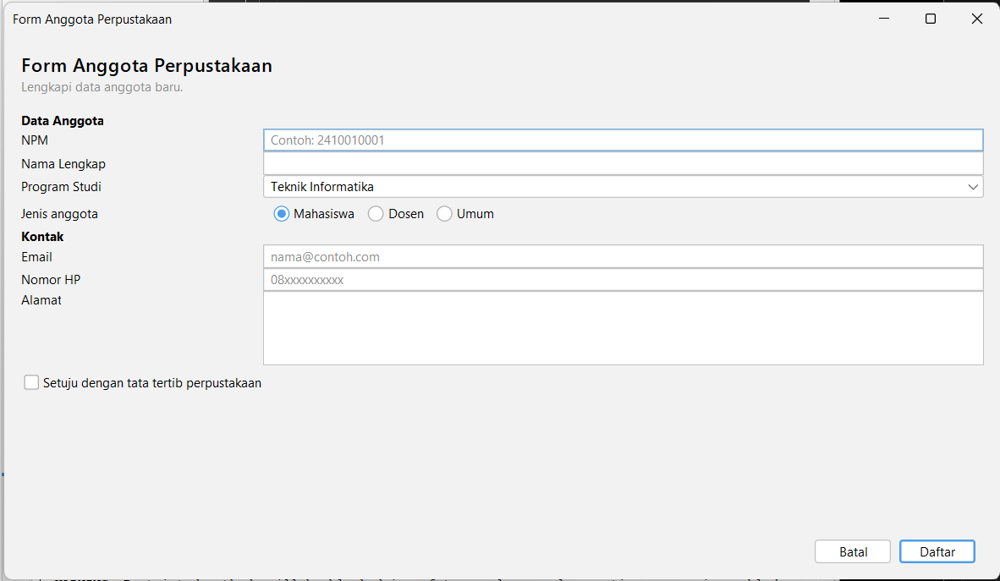
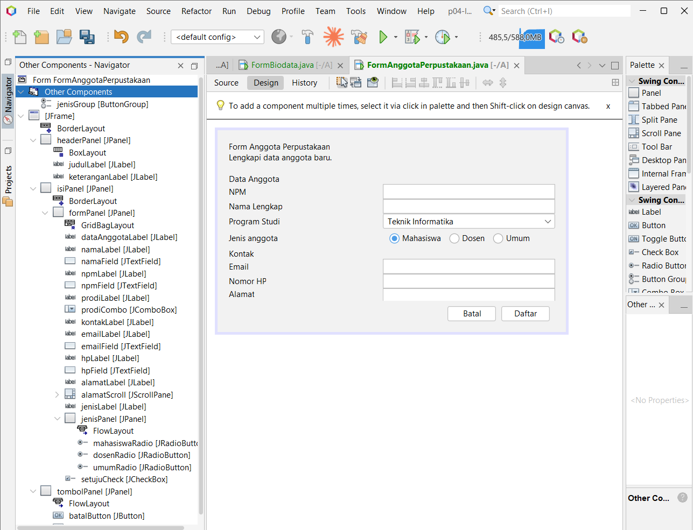

# p04-layout-manager

Tugas Pertemuan 4: Layout Manager dan Desain Form  
Mata Kuliah Pemrograman Berbasis Objek 2 (TIF1508), UNISKA Banjarmasin

- Nama:M. Rizqon
- NPM: 2410010374

## Isi Proyek

Package `id.ac.uniska.pbo2.p04`.

| Form | File |
|------|------|
| GaleriLayout | `GaleriLayout.java`, `GaleriLayout.form` |
| FormBiodata | `FormBiodata.java`, `FormBiodata.form` |
| FormAnggotaPerpustakaan | `FormAnggotaPerpustakaan.java`, `FormAnggotaPerpustakaan.form` |

Ketiganya dibuat dengan JFrame Form dan layout manager (tanpa Null Layout atau Absolute Layout), dengan tampilan FlatLaf.

---

## 1. Sketsa Form Anggota Perpustakaan



## 2. Tabel Rancangan

| Bagian | Panel | Layout |
|--------|-------|--------|
| Jendela | JFrame | BorderLayout |
| Header (North) | `headerPanel` | BoxLayout, Y Axis |
| Isi form (Center) | `isiPanel` (pembungkus), berisi `formPanel` di North | `isiPanel`: BorderLayout; `formPanel`: GridBagLayout |
| Tombol (South) | `tombolPanel` | FlowLayout, Alignment Right |

## 3. Tangkapan Layar FormAnggotaPerpustakaan

**Ukuran awal**



**Saat dilebarkan**



**Tab Design dan jendela Navigator**



---

### Praktikum 2 (GaleriLayout)

**Eksperimen 1: Alignment `flowPanel` menjadi Center.**
Tombol yang tadinya rata kiri menjadi rata tengah. Saat jendela dikecilkan, tombol yang tidak muat pindah ke baris berikutnya dan setiap baris tetap rata tengah. Baris di `initComponents()` yang ikut berubah:

```java
flowPanel.setLayout(new java.awt.FlowLayout(java.awt.FlowLayout.CENTER, 8, 8));
```

(sebelumnya `FlowLayout.LEFT`).

**Eksperimen 2: Rows 0 dan Columns 2 pada `gridPanel`.**
Terbentuk 5 baris. Jika Rows bernilai 0, GridLayout menghitung jumlah baris dari jumlah komponen dibagi jumlah kolom: 9 tombol dibagi 2 kolom = 4,5, dibulatkan ke atas menjadi 5. Baris terakhir hanya berisi satu tombol.

**Eksperimen 3: `maximumSize` tombol pada `boxPanel`.**
Tombol yang tadinya selebar teksnya sekarang melebar memenuhi lebar panel, karena BoxLayout mengikuti ukuran maksimum komponen. Vertical Strut menambah jarak vertikal tetap di antara tombol.

### Praktikum 4 (FormBiodata)

**Eksperimen 1: Weight X `namaField` menjadi 0.0.**
Lebar kolom isian di GridBagLayout ditentukan oleh bobot terbesar di kolom tersebut. Selama isian lain di kolom 1 masih ber-Weight X 1.0, kolom tetap melebar dan `namaField` (Fill Horizontal) tetap ikut memenuhi selnya. Isian baru berhenti melebar bila semua isian di kolom 1 diubah menjadi 0.0. *(Sesuaikan dengan hasil pengamatan.)*

**Eksperimen 2: Direction `formPanel` menjadi Center.**
Dengan North, `formPanel` hanya memakai tinggi yang dibutuhkannya sehingga baris form tetap menempel di atas. Dengan Center, `formPanel` diperluas memenuhi seluruh tinggi `isiPanel`, sehingga baris-baris form bergeser ke tengah secara vertikal dan muncul ruang kosong di atas dan bawah.

**Eksperimen 3: Tanpa `setMinimumSize(getSize())`.**
Saat jendela dikecilkan sekecil mungkin, komponen mulai terpotong: kolom isian menyempit dan label panjang terpotong, lalu tombol Batal dan Simpan ikut tergeser. *(Tulis bagian yang rusak lebih dulu menurut pengamatan sendiri.)*

---

## 5. Saran dari Teman (Tahap 4)

Pemeriksa: **M. Reza ikhsan fadila**

| No | Pemeriksaan | Ya atau Belum |
|----|-------------|---------------|
| 1 | Label singkat, jelas, dan sejajar | Ya|
| 2 | Isian dikelompokkan dengan judul bagian |Ya |
| 3 | Placeholder dipakai untuk isian yang punya format |Ya |
| 4 | Komponen sesuai jenis data |Ya |
| 5 | Tombol utama menonjol dan berada di kanan bawah | Ya|
| 6 | Jarak antar komponen konsisten |Ya |
| 7 | Form tetap rapi saat jendela dilebarkan dan ditinggikan | Ya|
| 8 | Tampilan dibuat dengan JFrame Form dan layout manager, bukan Null Layout atau Absolute Layout |Ya |

**Saran perbaikan dari Reza:**

*(Penulisan label belum seragam. Ada yang memakai huruf kapital di semua kata (“Nama Lengkap”) dan ada yang hanya di kata pertama (“Jenis anggota”). Sebaiknya dibuat sama.)*

---

## 6. Jawaban Pertanyaan Refleksi

**1. Mengapa Null Layout dan Absolute Layout sebaiknya dihindari?**
Dua layout ini menaruh komponen di posisi piksel yang tetap. Kalau jendela dilebarkan atau dibuka di layar dengan skala yang berbeda, komponennya tidak ikut menyesuaikan, jadi bisa terpotong atau menyisakan ruang kosong. Absolute Layout juga butuh library tambahan dari NetBeans, jadi proyeknya bisa gagal jalan di komputer lain. Setelah memakai layout manager di tugas ini, form saya tetap rapi waktu dilebarkan tanpa perlu menggeser komponen satu per satu.

**2. Jelaskan perbedaan perilaku FlowLayout dan GridLayout saat jendela dilebarkan.**
Di GaleriLayout, tombol pada FlowLayout tetap seukuran tulisannya waktu jendela dilebarkan. Kalau tidak muat, tombolnya pindah ke baris berikutnya. Pada GridLayout 3x3 semua tombol dibuat sama besar dan ikut melar mengisi selnya, jadi tombol "1" sampai "9" ikut membesar mengikuti jendela. Jadi FlowLayout cocok untuk deretan tombol seperti toolbar, sedangkan GridLayout cocok untuk susunan yang memang harus sama besar, seperti tombol kalkulator.

**3. Apa fungsi Weight X dan Fill pada constraint GridBagLayout?**
Weight X menentukan kolom mana yang mendapat sisa lebar saat jendela dilebarkan, dan Fill menentukan apakah komponen memenuhi sel yang didapat. Keduanya harus dipakai bersama. Kalau hanya ada Weight X, selnya melebar tetapi kotak isiannya tetap kecil. Kalau hanya ada Fill, kolomnya tidak ikut melebar. Di FormBiodata, label saya beri Weight X 0.0 supaya lebarnya tetap, sedangkan isian saya beri Weight X 1.0 dan Fill Horizontal supaya hanya kolom isian yang melebar.

**4. Mengapa formPanel dibungkus isiPanel dan diletakkan di North?**
isiPanel memakai BorderLayout, dan wilayah North hanya memakai tinggi yang dibutuhkan komponennya. Dengan begitu baris-baris form tetap menempel di bagian atas walau jendela ditinggikan. Kalau formPanel langsung dipasang di Center, ia akan ditarik memenuhi seluruh tinggi, dan baris-barisnya bergeser ke tengah dengan ruang kosong di atas dan bawah. Pembungkus ini jadi cara untuk menjaga posisi form tetap rapi di atas.

**5. Dua prinsip desain pada Form Anggota Perpustakaan dan buktinya.**

Keselarasan. Semua label saya taruh di kolom 0 dengan Anchor West, dan semua isian di kolom 1, sehingga label dan kotak isian membentuk garis lurus dari NPM sampai Nomor HP. Awalnya label saya masih rata tengah karena Anchor-nya belum West, dan setelah diubah barulah sejajar (lihat docs/anggota-awal.png).

Kedekatan. Isian yang berkaitan saya kelompokkan dengan judul bagian "Data Anggota" dan "Kontak". Tiga pilihan jenis anggota (Mahasiswa, Dosen, Umum) juga saya taruh dalam satu baris supaya terbaca sebagai satu pilihan (lihat docs/anggota-awal.png).

---

## 7. Deklarasi Penggunaan AI


**(memakai AI):**
Saya menggunakan Claude (Anthropic) untuk : panduan langkah pengerjaan di NetBeans, membantu memperbaiki error build, menyusun draf README. Seluruh form saya buat dan jalankan sendiri di NetBeans, dan sketsa, tangkapan layar, hasil pengamatan eksperimen, serta saran teman saya kerjakan sendiri.