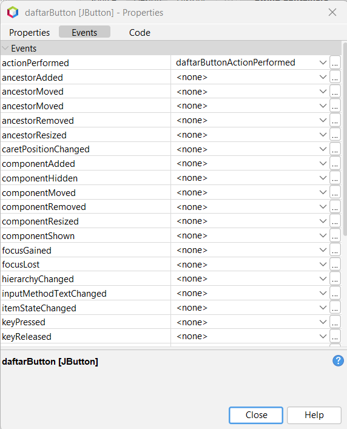
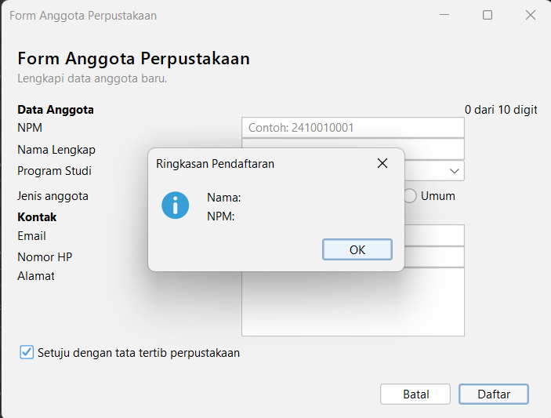
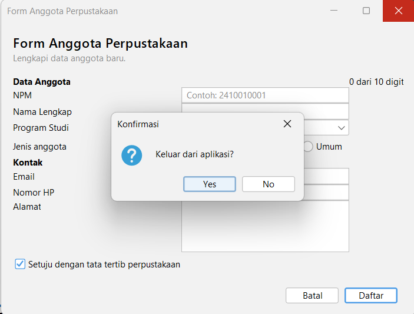

# Tugas 5: Event Handling

**Proyek:** `p05-event-handling`
**Mata Kuliah:** Pemrograman Berbasis Objek 2 (TIF1508), Pertemuan 5
**Nama:** M. Rizqon
**NPM:** 2410010374

## Isi Proyek

| Form / Kelas | Keterangan |
|--------------|------------|
| `PengamatEvent` | Praktikum 2: mencatat event ke area log |
| `KonverterSuhu` | Praktikum 3: kelas logika konversi (bukan form) |
| `KonversiSuhu` | Praktikum 3: form konversi suhu |
| `KalkulatorSederhana` | Praktikum 4: kalkulator dengan tiga cara menghubungkan event |
| `FormAnggotaPerpustakaan` | Latihan mandiri: form dari Pertemuan 4 yang sudah memiliki event |

Setiap form memiliki file `.java` dan `.form`. Event dibuat melalui **Events** di GUI Builder.

---

## 1. Tabel Pengamatan Praktikum 2 (PengamatEvent)

| No | Tindakan | Event yang tercatat |
|----|----------|---------------------|
| 1 | Arahkan kursor ke tombol, lalu jauhkan | `MouseEvent` kursor masuk ke tombol, lalu `MouseEvent` kursor keluar dari tombol |
| 2 | Klik tombol Klik saya | `MouseEvent` kursor masuk ke tombol, lalu `ActionEvent` tombol diklik |
| 3 | Centang lalu hapus centang Aktifkan fitur | `ItemEvent` kotak dicentang, lalu `ItemEvent` centang dihapus |
| 4 | Ganti pilihan dari Pagi menjadi Malam | `ItemEvent` memilih Malam (satu baris saja) |
| 5 | Klik isian, lalu ketik kata "abc" | `FocusEvent` isian mendapat fokus, lalu `KeyEvent` mengetik huruf a, b, dan c |
| 6 | Klik tombol setelah mengetik di isian | `MouseEvent` kursor masuk ke tombol, `FocusEvent` isian kehilangan fokus, lalu `ActionEvent` tombol diklik |

Catatan: saat jendela pertama kali dibuka, baris pertama log selalu `WindowEvent` jendela dibuka.

---

## 2. Jawaban Eksperimen Praktikum 3 (Konversi Suhu)

**Eksperimen 1: tanpa pemeriksaan `ItemEvent.SELECTED`.**
Pesan `item berubah` tercetak **2 kali** setiap pilihan combo box diganti. `itemStateChanged` dipanggil sekali untuk pilihan lama (`DESELECTED`) dan sekali untuk pilihan baru (`SELECTED`). Karena itu pemeriksaan `getStateChange() == ItemEvent.SELECTED` diperlukan agar konversi hanya berjalan sekali.

**Eksperimen 2: `keyReleased` diganti `keyPressed`.**
Hasil tampil terlambat satu karakter. `keyPressed` dipicu sebelum karakter dimasukkan ke dalam isian, sehingga `getText()` masih mengembalikan teks lama. `keyReleased` dipicu setelah karakter masuk, sehingga teksnya sudah lengkap.

**Eksperimen 3: blok `try` dan `catch` dihapus.**
Saat huruf diketik, `Double.parseDouble` melempar `NumberFormatException`. Di jendela Output muncul pesan `Exception in thread "AWT-EventQueue-0" java.lang.NumberFormatException: For input string: "..."`. Aplikasi tidak langsung tertutup, tetapi hasil tidak diperbarui dan pengguna tidak mendapat pesan yang jelas.

---

## 3. Jawaban Eksperimen Praktikum 4 (Kalkulator Sederhana)

**Eksperimen 1: event handler GUI Builder dan lambda pada `kaliButton`.**
Pesan `kali` tercetak **2 kali** setiap tombol diklik, karena dua listener terpasang pada tombol yang sama dan keduanya dijalankan. Satu tombol sebaiknya hanya memakai satu cara agar aksi tidak berjalan ganda (misalnya perhitungan atau penyimpanan terjadi dua kali) dan kode lebih mudah dirawat.

**Eksperimen 2: menambahkan tombol `%`.**
- Tab Design: tambahkan Button `modButton` bertuliskan `%` pada `operatorPanel`, ubah **Columns** Grid Layout dari 4 menjadi 5, lalu buat event `actionPerformed` melalui Events.
- Tab Source: isi `modButtonActionPerformed` dengan `hitung('%');`, tambahkan `case '%' -> a % b;` pada `switch` (tanpa ini `%` jatuh ke `default` dan malah membagi), serta ubah pemeriksaan nol menjadi `if ((operator == '/' || operator == '%') && b == 0)`.

**Eksperimen 3: tombol Hapus.**
Kursor langsung berada di isian pertama karena method `hapus` memanggil `angka1Field.requestFocusInWindow()`. Tanpa baris itu, fokus tetap berada di tombol Hapus yang baru diklik.

---

## 4. Peta Event FormAnggotaPerpustakaan

| Komponen | Menu Events | Aksi |
|----------|-------------|------|
| Kotak centang `setujuCheck` | Item: `itemStateChanged` | Tombol Daftar hanya aktif jika dicentang |
| Tombol `batalButton` | Action: `actionPerformed` | Mengosongkan semua isian dan mengembalikan fokus ke isian NPM |
| Tombol `daftarButton` | Action: `actionPerformed` | Menampilkan ringkasan data dengan `JOptionPane` |
| Isian `npmField` | Key: `keyReleased` | Label `digitLabel` menampilkan jumlah digit, misalnya "8 dari 10 digit" |
| Form (JFrame di Navigator) | Window: `windowClosing` | Meminta konfirmasi sebelum aplikasi ditutup |

Pengaturan di jendela Properties:

- `defaultCloseOperation` form = `DO_NOTHING`, agar jendela tidak tertutup sebelum pengguna menjawab konfirmasi.
- Properti `enabled` pada `daftarButton` tidak dicentang, sehingga tombol mati saat form dibuka.

Catatan desain: logika "kosongkan isian" ditulis satu kali pada method `kosongkanIsian()` dan dipanggil dari event handler tombol Batal, sehingga kode tidak berulang.

---

## 5. Tangkapan Layar

**Jendela Properties, bagian Events, tombol Daftar**

**Dialog ringkasan data**

**Dialog konfirmasi keluar**

---

## 6. Deklarasi Penggunaan AI

- Saya menggunakan **Claude (Anthropic)** untuk membantu menyusun langkah pengerjaan, kerangka README, dan penjelasan jawaban eksperimen. Seluruh kode saya ketik, jalankan, dan uji sendiri, dan tabel pengamatan saya isi berdasarkan log aplikasi saya.

